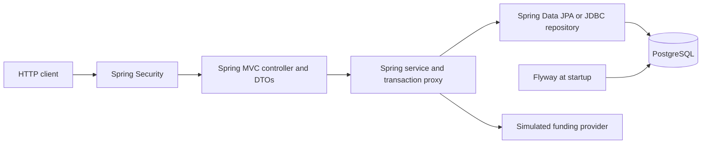
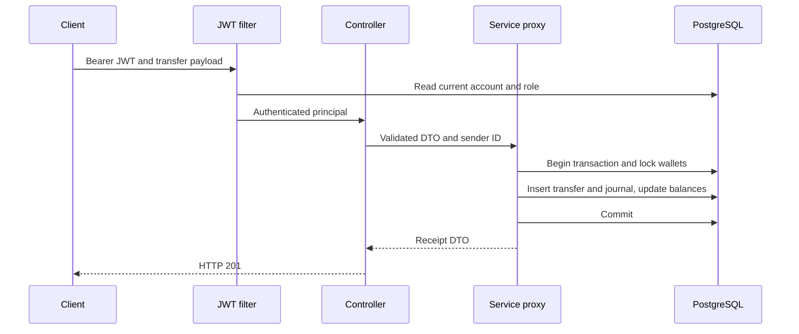

# Architecture

FinWallet runs as one Spring Boot application backed by PostgreSQL. Modules organize responsibilities inside a shared process and database. This keeps consistency-sensitive changes inside a single transaction and makes local development simple. Modules share a deployment lifecycle and compete for the same database resources.

Spring discovers controllers, services, and configuration during context startup. Constructor injection makes dependencies explicit. Spring Data creates repository implementations, while read models such as the funding journal and audit logs use parameterized SQL. Controllers parse HTTP and validate DTOs. Services select transaction boundaries and enforce state transitions. Repositories concentrate query and locking details. DTO projections avoid serializing persistence entities and make response fields explicit.

## Module interactions

| Module | Responsibility and collaboration |
| --- | --- |
| User and auth | Register, canonicalize email, hash passwords, issue tokens. Registration calls wallet creation inside its transaction. |
| Common security | Authenticate bearer tokens against the live user record and enforce endpoint roles. The dev route uses a scoped separate chain. |
| Wallet | Create and read wallet state, expose a shared locking query, and assemble wallet activity. |
| Transfer | Resolve sender and recipient, lock both wallets, post balances and transfer ledger, query history, and support trusted reversals. |
| Funding | Store pending intents and reservations, check simulator outcomes, post customer and settlement legs. |
| Admin and reconciliation | Lock wallets for status transitions, commit audit rows, and query financial invariants from one snapshot. |

## Protected write request

The [JWT filter](../src/main/java/finwallet_api/common/security/JwtAuthenticationFilter.java) runs before username/password authentication in the [customer chain](../src/main/java/finwallet_api/common/security/SecurityConfig.java). It verifies signed claims, finds the current user by subject, checks identity and active status, then populates the request security context. Security entry points handle rejected auth before MVC. The [controller advice](../src/main/java/finwallet_api/common/exception/GlobalExceptionHandler.java) maps validation and domain exceptions to HTTP responses and sanitizes recognized persistence failures.

## Transaction boundaries

- Registration and transfer posting use service transactions with the default isolation, typically PostgreSQL READ COMMITTED. Wallet creation joins the registration transaction.
- Funding creation uses READ COMMITTED. Funding settlement, trusted reversal, and admin status writes explicitly use READ COMMITTED with `REQUIRES_NEW` for a fresh transaction. Trusted callers should avoid holding locks on the target wallets when calling these methods.
- Audit and funding journal writes require a caller transaction (`MANDATORY`). Transfer history runs at REPEATABLE READ so its content and count use one snapshot. Reconciliation uses a fresh read-only REPEATABLE READ transaction across its checks. Wallet activity is read-only and returns a lookahead page.
- Proxy advice applies at a Spring-managed call boundary. Direct Java calls to an unproxied object and self-invocation do not activate a new annotation-defined transaction.

[Transfer service](../src/main/java/finwallet_api/transfer/service/TransferService.java) · [Funding settlement](../src/main/java/finwallet_api/funding/service/FundingSettlementService.java) · [Reconciliation service](../src/main/java/finwallet_api/reconciliation/service/LedgerReconciliationService.java)
