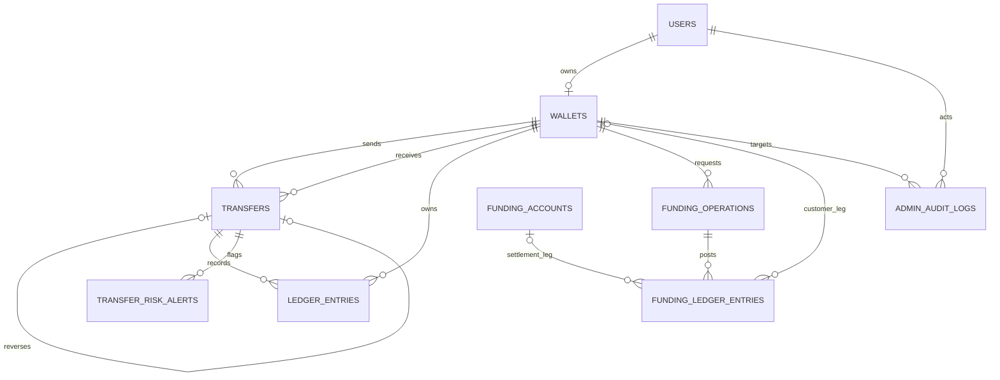

# Database and persistence

PostgreSQL is the durable source of account and financial state. Flyway loads numbered SQL migrations from [db/migration](../src/main/resources/db/migration). Hibernate validates mappings on startup. The application mixes JPA entities and JPQL DTO projections with parameterized JDBC for queries such as wallet activity, audit, and reconciliation.

## Relationships

The schema enforces at most one wallet per user. Registration enforces creation for a newly registered user. Journal pairs are enforced through the posting service and checked through reconciliation. Unique entry-direction keys prevent duplicate legs but cannot require both legs to exist.

| Table | Keys, rules, and indexes |
| --- | --- |
| `users` | Identity `id` PK, unique `email`, BCrypt `password_hash`, `full_name`, timestamps. Status is ACTIVE, SUSPENDED, or CLOSED. Role is ROLE_USER or ROLE_ADMIN and defaults to ROLE_USER. |
| `wallets` | Identity `id` PK, unique `user_id` FK. `balance >= 0` and `0 <= reserved_balance <= balance`. Currency defaults to MYR. Status is ACTIVE, FROZEN, SUSPENDED, or CLOSED. |
| `transfers` | Identity `id` PK, unique `reference`, sender and recipient wallet FKs. Positive amount, distinct wallets, status COMPLETED or FAILED. Unique `(sender_wallet_id,idempotency_key)`. Original transfers require a key. Reversals require a unique self-FK `reversal_of_transfer_id`, a null key, and COMPLETED status. Cannot reference their own ID. Sender and recipient indexes also have history variants with descending `created_at,id`. |
| `ledger_entries` | Identity `id` PK, transfer and wallet FKs, positive amount, DEBIT or CREDIT. Unique `(transfer_id,entry_type)` plus indexes on transfer and wallet. |
| `funding_accounts` | `code` PK. Restricted to `SIMULATED_MYR_SETTLEMENT` in MYR. |
| `funding_operations` | Identity `id` PK, wallet FK, unique public and provider references, unique nullable provider event reference. Unique `(wallet_id,operation_type,idempotency_key)`. Positive MYR amount. PENDING has no event or resolution time, COMPLETED and FAILED require both. History index on `(wallet_id,created_at DESC,id DESC)`. |
| `funding_ledger_entries` | Identity `id` PK, operation FK, exactly one of wallet FK or account-code FK. Positive MYR amount. Unique `(operation_id,entry_type)`. |
| `admin_audit_logs` | Identity `id` PK, administrator user and target wallet FKs. Nonblank reason, action/target status consistency and outcomes consistent with the before/after statuses. Index on descending `occurred_at,id`. |
| `transfer_risk_alerts` | Identity `id` PK, `transfer_id` FK, checked rule and occurrence time, unique `(transfer_id,rule)`. Indexed by descending timestamp and ID for the admin report. |
| `flyway_schema_history` | Flyway-managed version, checksum, and execution metadata. It is separate from the business model. |

Unique constraints create supporting PostgreSQL indexes. A foreign key alone does not create an index on its referencing column.

## Migration history

V1 users, V2 wallets, V3 transfers, V4 transfer journal, V5 unique journal directions, V6 history indexes, V7 reversal links and keys, V8 funding and reserves, V9 roles, wallet freeze status and audit, V10 transfer risk alerts. Use a new migration to change a shared schema. Editing an already-applied file can cause a checksum mismatch.

Amounts use Java `long`/`Long` and PostgreSQL `BIGINT` in integer sen. RM100 = 10,000 sen. Available balance is posted balance minus reserved balance. Reconciliation aggregates only completed transfers (including reversals) and completed funding. Customer wallet totals use wallet legs only, while simulated settlement uses its separate account legs. Pending withdrawal amounts are checked independently against the reserve. An SQL integer range is larger than JavaScript’s safe integer range, so API clients need a precision policy. `TIMESTAMPTZ` stores instants. Posting timestamps used in replay-sensitive paths are truncated to PostgreSQL microsecond precision.

## Persistence and transactions

Entity mappings use scalar IDs in several relationships, with database FKs protecting the links. That keeps lock queries and DTO projections explicit. `findIdByUserId` resolves identity before `findByIdWithLock` takes a pessimistic write lock. Financial writes commit or roll back together. At READ COMMITTED, competing writers wait on the wallet lock and check current state after acquiring it. Transfer history and reconciliation use REPEATABLE READ for stable snapshots across related reads.

[Wallet repository](../src/main/java/finwallet_api/wallet/repository/WalletRepository.java) · [Transfer repository](../src/main/java/finwallet_api/transfer/repository/TransferRepository.java) · [Funding migration](../src/main/resources/db/migration/V8__wallet_funding.sql)
