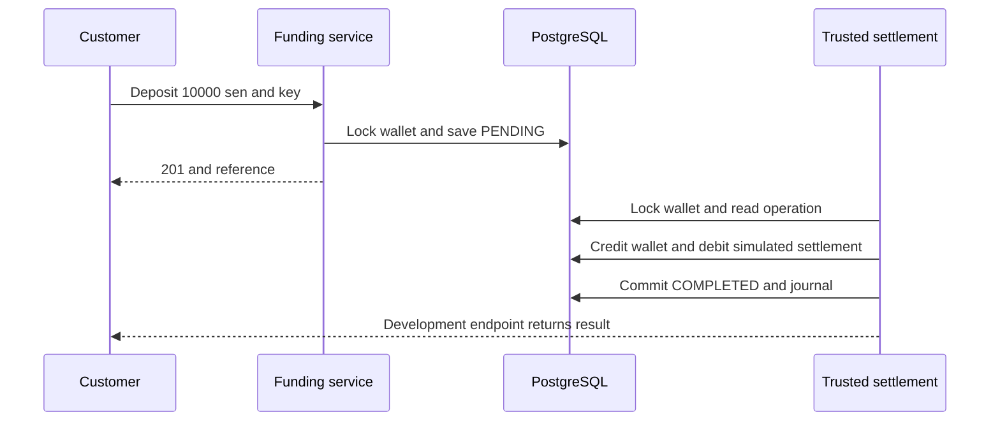

# Financial workflows

The examples start with fresh MYR wallets. RM100 is 10,000 sen, RM30 is 3,000 sen, and RM70 is 7,000 sen.

## Registration and login

1. Register with a valid email, full name, and password. `UserService` canonicalizes email, hashes the password, stores the ACTIVE user, and creates an ACTIVE wallet with zero balance. User and wallet writes share the same transaction. If wallet creation fails, registration rolls back. The unique email and wallet-owner keys protect against racing duplicate requests.
2. Login checks the stored BCrypt hash and current user status and returns a signed JWT on success. The JWT filter rechecks the account on later protected requests. Login reads account state and creates no financial rows.

[UserService](../src/main/java/finwallet_api/user/service/UserService.java) · [AuthService](../src/main/java/finwallet_api/auth/service/AuthService.java)

## Deposit and withdrawal

1. The authenticated customer submits a positive amount in sen and an idempotency key. The funding service resolves and locks the wallet. It checks for a matching earlier operation before validating a new one. New operations require an ACTIVE MYR wallet. A withdrawal additionally requires enough available funds.
2. A deposit inserts a PENDING operation with no balance or journal effects. A withdrawal inserts a PENDING operation and increases the reserve in the same transaction. With RM100 posted, reserving RM30 gives RM70 available and leaves RM100 posted.
3. The settlement service starts a fresh transaction, locks the wallet and verifies the simulated provider transaction reference. SUCCESS makes the operation COMPLETED and posts a balanced pair. FAILURE marks it FAILED without journal entries. TIMEOUT is an internal scenario that preserves current state and holds. The dev HTTP trigger offers SUCCESS or FAILURE.
4. A deposit SUCCESS adds the amount to posted balance. A withdrawal SUCCESS decreases posted balance and releases the hold. A withdrawal FAILURE releases the hold without decreasing posted balance. A repeated terminal event returns the same result. A conflicting final outcome returns 409. Previously pending funding can resolve after the wallet is frozen.
5. Wallet, terminal state and journal commit together. If any write fails, the transaction rolls back. Successful deposit posting uses checked addition. There is no actual bank payment or externally verified settlement.

[FundingService](../src/main/java/finwallet_api/funding/service/FundingService.java) · [FundingSettlementService](../src/main/java/finwallet_api/funding/service/FundingSettlementService.java) · [FundingJournalRepository](../src/main/java/finwallet_api/funding/repository/FundingJournalRepository.java)

## Wallet-to-wallet transfer

1. Spring derives the sender from the JWT. The service resolves the recipient by email and locks both wallets in ascending ID order. It looks up the sender-scoped key under the lock. The same recipient wallet, amount, and description return the original receipt, even if funds have since been spent.
2. For a new transfer, wallets must exist, differ, be ACTIVE, and use matching currencies. The amount must fit the sender’s available balance, and the recipient balance must fit the integer range after credit.
3. Configured per-transfer and daily limits apply to new outgoing customer transfers under the sender lock. Reversal postings preserve the original quota charge. [Transfer policy](transfer-limits-and-risk.md) explains the day boundary and alert rules.
4. Sending 3,000 sen from Alice to Bob creates a completed transfer, subtracts 3,000 from Alice, adds 3,000 to Bob, and inserts both ledger entries. After Alice’s 10,000-sen deposit, Alice has 7,000 and Bob 3,000. Validation failures and rollback produce no partial posting.
5. If the client loses the response, retry with the exact payload and key. A different payload with the same key conflicts. A new key authorizes a new intent. There is no transfer lookup by idempotency key.
6. The trusted reversal service creates a separate opposite-direction transfer linked to the original, under the same lock ordering and funding rules. The original history remains available. One reversal per original is enforced. A reversal can fail when the original recipient has spent or reserved the funds.

[TransferService](../src/main/java/finwallet_api/transfer/service/TransferService.java) · [Reversal design](transfer-reversals.md)

## Journals, locking and history

Each successful posting records equal amounts and matching currency on opposite legs. The transfer ledger debits Alice and credits Bob for 3,000 sen. The funding journal credits Alice and debits the simulated settlement account for 10,000 sen. The settlement account tracks simulated net movement and has no spendable balance.

Pessimistic row locks serialize competing changes. Stable lock ordering reduces deadlocks between transfers in opposite directions. A lock does not replace database uniqueness, and a uniqueness rule does not protect available-balance arithmetic. Both are needed. Reconciliation checks expected posted balance from completed transfers, completed reversals, and completed customer funding legs. It checks settlement-account legs against completed withdrawals minus completed deposits. Pending withdrawals contribute only to the reserve. Unexpected entries on noncompleted operations are reported separately and excluded from posted totals. The report leaves records untouched.

Transfer history is owner-scoped, includes reversals, and calculates INCOMING/OUTGOING relative to the caller. Wallet activity adds funding operations and can show pending or failed outcomes. A pending item is an intent rather than a posted movement. Offset pagination is ordered by timestamp and a tie-breaker. Concurrent new entries can shift later pages across separate requests.

[History and reconciliation](transfer-history-and-reconciliation.md) · [Activity repository](../src/main/java/finwallet_api/wallet/repository/WalletActivityRepository.java)
